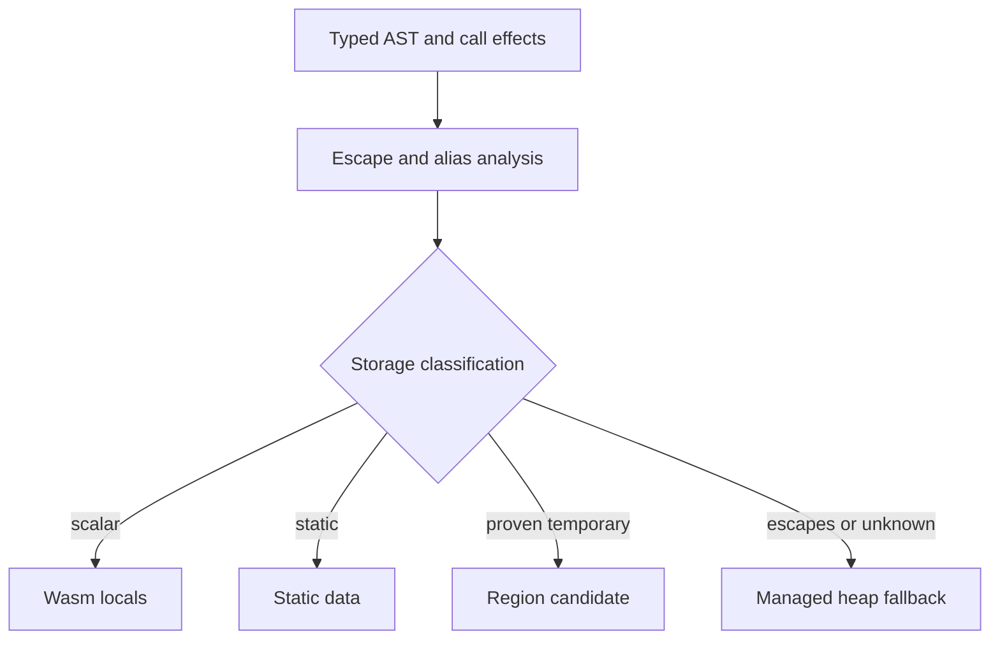
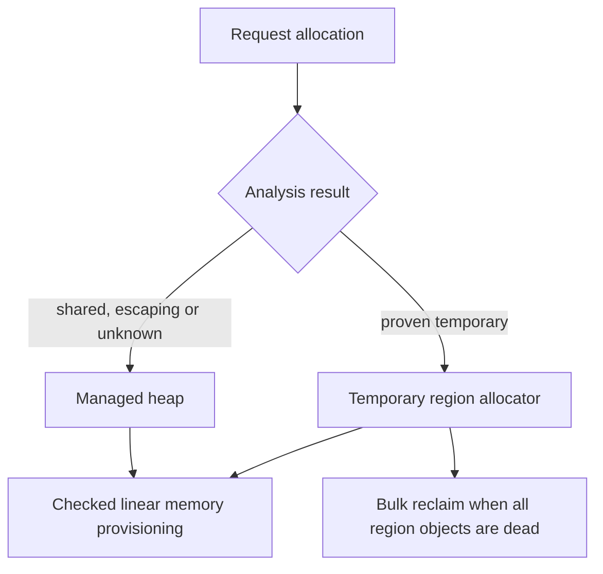
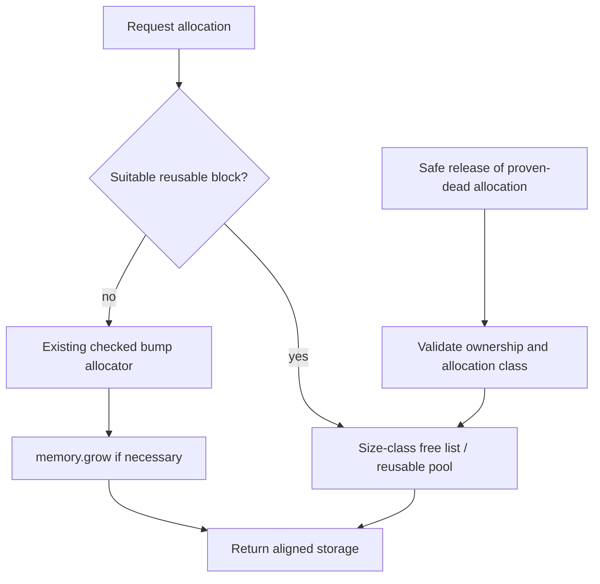
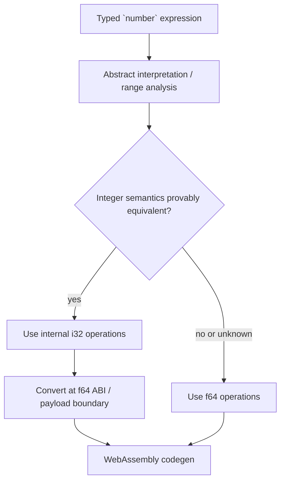
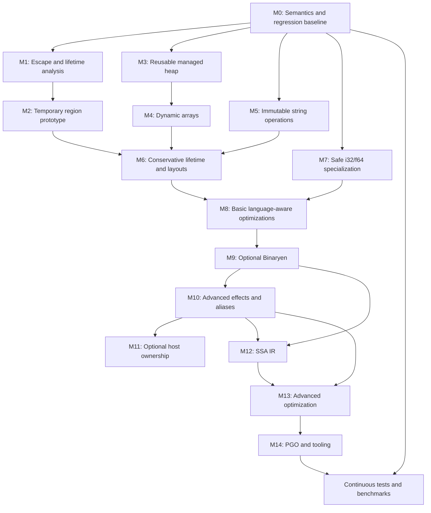

# WAS Compiler — Memory, Numeric Representation, and Optimization Roadmap

**Status:** Proposed technical plan; M0 implemented and validated (later milestones remain proposals)

**Updated:** October 26, 2026

**Version:** 2.0 — Goose-informed memory strategy  
**Repository:** https://github.com/LuanRoger/was-compiler  
**Scope:** Stabilize runtime values and memory management; introduce conservative escape/lifetime analysis and temporary regions; add safe reclamation for shared heap objects and resizable arrays; preserve practical immutable string operations; introduce `i32`/`f64` specialization and an optional Binaryen pipeline.  
**Explicitly deferred:** Multi-file modules, package management, additional execution targets, the Component Model, and a native-code backend.

> **Evidence boundary.** The “Current state” section summarizes the repository's public `main` branch and the previously conducted architecture review. Implementation proposals, hypothetical examples, and acceptance criteria are not claims about existing functionality. Paths and behavior should be revalidated against the branch used when each milestone begins. No tests were executed during the original plan preparation; subsequent M0 implementation and validation evidence is linked in §4.

---

## 1. Executive summary

The WAS compiler already has a useful foundation: a Rust frontend and typed representation, a `wasm-encoder` backend, Core WebAssembly output, typed arrays, immutable UTF-8 strings, ranges, local closures with shared captures, and a documented memory ABI. The key limitation is not the correctness of basic linear-memory allocation; it is **object lifetime**. The current monotonic allocator grows memory but does not reclaim dead objects or obsolete buffers.

The revised progression is:

1. **Freeze semantics and establish memory regression tests (M0).** Make aliases, host ownership, reentrancy, traps and ABI invariants explicit.
2. **Introduce conservative escape and lifetime analysis (M1).** Classify storage as scalar, static, temporary-region, or shared/escaping heap without adding source-language ownership syntax.
3. **Prototype reclaimable temporary regions (M2).** Reuse storage when all allocations in a region are proven dead; begin with narrowly proven local cases.
4. **Add managed-heap allocation/reuse infrastructure (M3).** Retain the checked bump allocator as a fallback; do not conflate allocation reuse with determining whether an object is dead.
5. **Implement resizable arrays (M4) and practical immutable string operations (M5).** Preserve aliasing, descriptor identity and host ABI guarantees.
6. **Refine lifetime and storage representations (M6).** Optimize nonescaping closure environments, ranges and temporary objects; selectively consider inline layouts.
7. **Specialize numeric operations (M7).** Preserve source `number` semantics and public `f64` boundaries when choosing `i32` internally.
8. **Add language-aware optimization (M8) and optional Binaryen integration (M9).** Measure and validate every stage against unoptimized Wasm.

Continuous regression tests and benchmarks gate all milestones.

**Main recommendation:** Adopt a **hybrid region + managed-heap architecture** inspired by Goose, not Goose’s data-stack layout verbatim. Regions may reclaim provably temporary allocations cheaply; arrays or objects with uncertain/shared lifetimes still need safe heap allocation and an explicit reclamation policy. Do not equate `free` with automatic memory management.

---

## 2. Verified baseline and existing constraints

| Area | Current design / evidence | Consequence |
|---|---|---|
| WebAssembly representation | Core Wasm, `memory32`, `wasm-encoder` | The runtime operates on integer memory offsets and linear memory. |
| Memory provisioning | Monotonic bump allocation; 8-byte allocation alignment; guarded `memory.grow` | Allocation is simple, but memory is not recovered during an instance's lifetime. |
| Allocation safety | Allocation arithmetic uses widened `i64` intermediates and checks growth/limits before committing the heap pointer | Preserve these invariants if adding a free-list allocator. |
| Public string/array descriptor | 8 bytes: `data_ptr: u32` at `+0`, `length: u32` at `+4` | Public consumers and validation code assume this layout. |
| `number[]` payload | Eight bytes per element (`f64`) | Must not silently change because an optimizer discovers integral values. |
| `bool[]` payload | One byte per element | Typed allocation and validation must remain consistent. |
| `string[]` payload | Four-byte string handles per element | String lifetimes interact with arrays and host-visible handles. |
| Strings | UTF-8, immutable; literal interning in the static data region | In-place edits of interned objects would be unsafe without a different representation. |
| Arrays | Mutable elements; fixed logical length; reference/handle-sharing on assignment and calls | Resizing must update all aliases consistently. |
| Ranges | 32-byte private records containing progression metadata | Many direct `for` loops could eventually avoid record allocation. |
| Closures | Locally callable helpers; shared by-reference captures; 8-byte capture cells and environment slots | Correct lifetime and reentrancy are essential; current allocations are monotonic. |
| `number` ABI | `f64` for function parameters/results and numeric-array elements | Internal `i32` specialization must insert conversions at boundaries and preserve observable semantics. |
| Host integration | Node and browser adapters use documented descriptor handles | ABI changes require coordinated updates and regression tests. |

### Relevant implementation entry points

- [`crates/compiler/src/codegen/memory.rs`](https://github.com/LuanRoger/was-compiler/blob/main/crates/compiler/src/codegen/memory.rs) — memory planning, static string interning, allocator, validators, equality helpers.
- [`crates/compiler/src/codegen/abi.rs`](https://github.com/LuanRoger/was-compiler/blob/main/crates/compiler/src/codegen/abi.rs) — descriptor offsets, payload widths, range records, capture-cell sizing, Wasm type mapping.
- [`crates/compiler/src/codegen/values.rs`](https://github.com/LuanRoger/was-compiler/blob/main/crates/compiler/src/codegen/values.rs) — allocation and lowering of value constructors.
- [`docs/memory-abi.md`](https://github.com/LuanRoger/was-compiler/blob/main/docs/memory-abi.md) — public contract and host integration guidance.
- [`README.md`](https://github.com/LuanRoger/was-compiler/blob/main/README.md) — language implementation status and validation milestones.

### Baseline memory model

```text
Static data / interned literals
           |
           v
[ reserved ][ descriptors and static bytes ][ heap allocations ... ][ available space ]
                                                 ^
                                                 monotonic heap cursor

Every heap allocation moves the cursor forward.
Dead arrays, ranges, closure environments, and superseded buffers do not automatically return space.
```

**Strength worth retaining:** allocations are explicit in generated Wasm and the compiler already separates runtime helpers from most source-language semantics.

---

## 3. Design principles and invariants

1. **Preserve source semantics before optimizing representation.** A backend optimization may change the implementation, not the results or specified traps.
2. **Keep host-visible handles stable.** Resizing an object must not invalidate aliases to its object descriptor. Payload pointers may move only if no outstanding contract promises their stability.
3. **Document ownership at each boundary.** Distinguish compiler-owned data, host-allocated data, static interned data, and temporary runtime storage.
4. **Do not reclaim live aliases.** In particular, arrays, string handles in arrays, closure captures, and exported values may remain reachable after an expression or function returns.
5. **Avoid in-place mutation of shared immutable data.** Literals and aliased immutable strings must not change unexpectedly.
6. **Use conservative fallbacks.** Unknown numeric ranges use `f64`; unknown object lifetime uses safe nonreclamation until a sound reclamation strategy exists.
7. **Make failures observable and testable.** Define invalid indexing, capacity overflow, allocation failure, partial modification, and mutation-during-iteration behavior.
8. **Keep Core Wasm portable.** Neither Binaryen nor a new allocator should become a required runtime import.
9. **Prefer incremental changes.** Establish tests and invariants, then evolve the existing backend without a mandatory large IR rewrite.
10. **Region reset requires proof of aggregate death.** A lexical scope boundary alone never authorizes rewinding a global heap cursor. Escaping values and interleaved heap allocations must be isolated.
11. **Separate stable handles from movable payloads.** `memory.grow` preserves Wasm linear-memory offsets, but an array resize may move its payload.
12. **Keep analysis conservative.** When aliasing, host effects, or reentrancy is unknown, use the established heap path, not optimistic region reclamation.

---

## 4. Milestone M0 — Semantics and regression baseline

**Goal:** Define the behavioral contract before changing the representation.

### M0 interview decisions (2026-10-26)

The user confirmed the consolidated scope and authorized M0 implementation on
2026-10-26. M0 is implemented with [recorded coverage, measurements and passing
validation](m0-memory-baseline.md). These decisions do not authorize implementation
of later milestones; future-feature constraints below remain proposals.

- **M0 scope:** documentation, focused regression tests and test-only measurement
  support. Preserve current language behavior, emitted ABI, allocation policy and
  adapters. No escape analysis, reclamation, capacity fields or numeric-policy
  changes. Future resize/string-operation contracts remain explicitly proposed.
- **Collection direction:** M4 proposes resizing the existing `number[]`, `bool[]`
  and `string[]` types, not adding a separate growable-list type. Resizing through
  one alias would change the same collection observed by all aliases. Existing
  arrays remain fixed-length until that feature is implemented. Future operation
  syntax remains deferred; the proposed iteration interaction is defined below.
- **Raw-host compatibility:** preserve existing instance-lifetime storage and raw
  handle-retention rights without retroactive root-registration, release or
  nonretention obligations. A compliant host's retained handle remains valid
  after a guest trap and during later calls. Future reclamation must respect this
  contract or use an explicitly separate opt-in ownership protocol; return or
  trap alone cannot invalidate retained handles.
- **Validity is not ownership:** descriptor bounds/alignment checks do not prove
  allocation provenance or authorize freeing, relocation or resizing. Compliant
  raw descriptors remain accepted unchanged. Explicit Node encoding copies into
  guest storage, but current descriptors contain no ownership metadata. A future
  management protocol must establish management rights separately; M0 adds none.
- **Failure and effects:** a failed allocation does not advance the allocator
  cursor or corrupt existing descriptors. Completed writes, host effects and
  earlier successful allocations survive traps; there is no operation-wide
  rollback. Future resize replacement-allocation failure must leave the old
  descriptor/storage valid, without rolling back prior argument effects.
- **Proposed string operations:** require immutable result contents without
  modifying existing strings, not fresh allocation or distinct physical identity
  on every invocation. Unchanged/already available results may reuse storage.
  Allocation and failure rules remain operation-specific future decisions.
- **Measurement boundary:** use existing test-only measurements, with initial/final
  pages on fresh unmarked runs and aligned bump consumption on separate marked
  runs, correcting marker overhead. Pages are capacity, not live bytes. General
  allocation counts and peak live bytes remain unavailable unless independently
  measured; never infer them from page growth. No new production counters,
  exports or allocator behavior are authorized.
- **Proposed resize/iteration semantics:** capture the handle and initial length
  once; read current elements by checked index, without an element snapshot or
  cached payload pointer. Appends beyond the initial length are not visited. If
  shrinking invalidates a subsequent index, that read traps rather than ending
  iteration early. Any future shifting removal affects subsequent indexed reads;
  there is no exactly-once guarantee for original elements.
- **Proposed pointer contract:** descriptor handles remain stable across resize,
  but payload addresses need not. Hosts must reacquire payload addresses after
  calls/reentrant callbacks that may resize, separately from refreshing JavaScript
  views after memory growth. M0 adds no pinning API and does not weaken current
  fixed-storage lifetime guarantees. Future lowering must preserve pre-RHS checked
  assignment-place semantics: moving storage must not invalidate or silently
  retarget an outstanding checked write.
- **Contract revision:** identify the existing memory/ownership contract as
  revision 1 in a dated compatibility section of `memory-abi.md`. This is a
  documentation revision, not a new binary ABI, version export, descriptor tag or
  runtime negotiation mechanism. Keep future features outside the implemented
  revision's guarantees.
- **Acceptance evidence:** map contracts to existing tests and add focused coverage
  only for gaps, including retained `bool[]` and `string[]` through reentry, caught
  traps and actual growth. Require fresh offline fast/full validation, ignored
  runtime cases and current-source rebuilt-browser evidence, plus separate
  page/consumption records with workload/tool-version provenance. Missing tools
  leave gates pending; historical results and default Cargo success alone do not
  close M0. Preserve compatibility fixtures; proposals for unimplemented features
  do not require executable feature tests in M0.

### Contract summary (existing guarantees versus future proposals)

| Topic | Proposed decision | Reason |
|---|---|---|
| Array assignment | Reference semantics: `b = a` refers to the same array object | Matches current behavior. |
| Array growth | Proposed: descriptor/handle stable; backing payload may move | Lets aliases observe resize; not implemented by M0. |
| Array iteration | Initial length and live checked reads; proposed shrinking traps at an invalid next index | Appends do not extend iteration; no element snapshot. |
| Array bounds | Checked access; invalid indices trap | Matches the existing checked model. |
| String assignment | Immutable value/handle semantics | Prevent accidental mutation of shared literals. |
| String edits | Proposed immutable results; fresh allocation is not mandatory | Keeps shared strings safe without requiring allocation for unchanged results. |
| Host-originated arrays | Preserve raw acceptance; validity does not establish management rights | Future resize/reclamation needs a separately specified management protocol. |
| Raw memory addresses | Proposed: reacquire payload addresses after possible resize; no pinning API in M0 | Distinct from JavaScript view refresh after growth. |
| Allocation failure | Failed allocation leaves cursor unchanged; completed effects remain | Preserve live descriptors without promising transactional rollback. |
| Reentrancy | Recursive and host-reentrant invocations must not share mutable scratch unsafely | Necessary for closure correctness. |

### Deliverables

- A short **memory/ownership contract revision 1**, updating `docs/memory-abi.md`
  with a dated compatibility section and no binary ABI or runtime-version changes.
- A contract-to-test coverage map for existing strings, typed arrays, captures,
  exports, traps and memory growth; reuse current suites and add focused tests for
  uncovered guarantees, including integrated bool/string-array retention scenarios.
- Test-only measurements of memory pages and aligned bump consumption on separate
  runs using existing support; explicitly mark allocation counts and peak live
  bytes unavailable unless independently measured. Do not add production telemetry.
- An explicit policy for compatibility with existing Node/browser marshaling.

**Exit gate:** Existing tests pass without weakening assertions or regenerating
compatibility fixtures; uncovered implemented guarantees receive focused tests.
Complete the offline fast/full validation in [validation.md](validation.md), with
ignored runtime cases and a current-source browser rebuild, and record separate
page/consumption measurements with workload/tool-version provenance. Missing
prerequisites leave gates pending. No language, binary ABI, allocator or adapter
behavior changes are permitted in M0; future-feature proposals remain labeled and
are not claims of tested functionality. The 2026-10-26 implementation meets this
M0 gate; see the [evidence record](m0-memory-baseline.md#validation-2026-10-26).

---

## 5. Milestone M1 — Conservative escape and lifetime analysis

**Goal:** Identify provably temporary objects before changing the allocator. The analysis must remain conservative, with the current heap as a sound fallback.

**M1 status — 2026-10-26:** #50–#52 implement private `cfg(test)` classification
and noninterference tests; #53's fresh offline fast/full gates passed, including
all ignored native runtimes and current-source rebuilt-browser tests. The
[implemented contract, test map and evidence](m1-lifetime-analysis.md) record
1,392 native plus 13 browser tests passed, none failed/ignored in the full runs.
Only direct function-body let-bound array literals are inventoried; the positive
set is the closed number/bool-array subset below. There is no production or
emission consumer. Classification selects no storage and changes no bytes, ABI,
presets, allocator or host retention rights. M2, reclamation and managed-heap
support remain unimplemented and unauthorized; no memory/performance improvement
is claimed. Broader design examples and future proof obligations below are not
implemented M1 interfaces.

### M1 interview decisions (2026-10-26; confirmed)

The user confirmed the consolidated M1 contract on 2026-10-26, completing the
interview. The decisions below define the agreed scope subsequently implemented
under #50–#53. They do not authorize reclamation in M2.

- **Analysis only:** internal classification and classification tests, without
  changes to allocation, emitted Wasm bytes, ABI, language, numeric presets or
  adapter behavior. Require identical bytes with and without the analysis.
- **Separate concepts:** distinguish allocation origin, escape-analysis results
  and future storage decisions. A temporary candidate still uses the existing
  monotonic heap. The illustrative `StorageClass` below is not an approved M1
  interface, and `ManagedHeap` does not describe a new implemented allocator.
- **Initial positive slice:** local `number[]` and `bool[]` allocations consumed
  within straight-line code in their allocating function, without branches,
  loops, calls, captures or returned handles. String arrays, ranges, capture cells
  and environments are outside the initial positive set. Aliases and other
  interactions require later proof decisions; excluded cases receive conservative
  classification tests rather than speculative positive proofs.
- **Host observation barrier:** a host call during a candidate's lifetime blocks
  the initial positive proof even without handle arguments/results. Exported
  memory and possible reentry preclude equating absent handle arguments with
  absent observation. Add no host purity, nonretention or nonreentrancy promises.
- **Invocation-wide proof boundary:** require the entire allocating function body
  to satisfy the supported subset, rather than finding eligible fragments or
  computing last uses. Calls, branches, loops and callable declarations block
  the initial positive proof even when apparently unreachable. Candidate status
  bounds lifetime by the invocation; it selects no early reclamation point.
- **Single-binding origins:** positive candidates are array literals bound
  directly to one ordinary `let`, without copying their handle to another binding
  or reassigning that binding. Reads, `len` and checked element writes are allowed
  in principle; exact supported expression forms remain to be settled. Local
  aliases and handle reassignment are unproven, not necessarily escaping.
- **Distinct outcomes:** separate temporary candidates, identified escape paths
  (including returned handles and passage to potentially retaining hosts), and
  unproven cases outside the supported analysis. Record conservative reasons;
  identified escape and unproven cases both retain current storage. These are
  analysis results, not source-language types or proof of actual host retention.
- **Private borrowed metadata:** keep facts internal and associated with the
  borrowed typed tree. Add no public AST fields, allocation/expression IDs or
  ownership annotations. Exact metadata representation remains a technical design
  detail. Preserve independent backend validation of mutable/forged typed input;
  caller-supplied annotations cannot authorize temporary storage.
- **Closed positive-operation set:** admit scalar literals, scalar parameters and
  ordinary number/bool locals; directly let-bound number/bool array literals;
  scalar arithmetic, comparisons and unary operators; element reads, builtin
  `len`, checked element assignments and numeric element compounds; and scalar
  or bare returns. Element expressions and indices must themselves satisfy the
  supported subset. Block expressions, if/match, loops, short-circuit operators,
  calls other than builtin `len`, and other handle uses remain outside the initial
  positive proof. Unknown forms default to unproven, never implicit acceptance.
  Test each admitted operation; widening this set requires an explicit decision.
- **Traps do not imply escape or reclamation permission:** candidate proofs need
  not establish trap freedom or normal completion. Preserve completed effects and
  earlier allocations after traps. M2 must separately establish safe reclamation
  across traps, reentry and suspended invocations; candidate status alone is not
  sufficient proof for cleanup or cursor restoration.
- **Explicit analysis, no production consumer:** exercise the internal component
  explicitly in tests, without enabling it by default in compilation or tying it
  to optimization presets. Code emission does not consume its classifications.
  Verify identical emitted bytes for the same borrowed tree before and after
  analysis, separately within each optimization preset. Storage-selection
  integration is deferred to M2.
- **M1 acceptance:** positive coverage for both array types and every supported
  operation; conservative cases for direct/indirect returns, aliases, reassignment,
  captures, internal calls, recursion, hosts, reentry and control flow; trap and
  forged-typed-tree cases without weakening backend checks; deterministic facts,
  checkable reasons and per-preset byte identity. Require fresh offline fast/full
  validation from `validation.md`, including ignored runtime cases and a
  current-source browser rebuild. Missing prerequisites leave gates pending.
  No page-count, allocation-consumption or execution-time improvement is required:
  M1 changes no storage. These were planned gates at interview time; #53's actual
    completed results are linked in the M1 status above.

### Core design

Track object origins and propagation through local bindings, calls, returns, arrays, closures, and host boundaries. Do not presume that a value is nonescaping simply because its local variable is out of scope. A by-reference closure capture is an alias; a returned array and an object shared with a host must be conservatively classified as escaping or externally rooted.

```rust
// Illustrative compiler-internal analysis result, not a source-language type.
enum StorageClass {
    WasmLocal,       // numeric/bool scalars or scalar-replaced aggregates
    StaticData,      // literals/interned immutable values
    TemporaryRegion, // proven aggregate lifetime
    ManagedHeap,     // escaping, shared or lifetime-unknown values
}
```



### Conservative first slice

- Begin with straight-line, local arrays or temporary records fully consumed by the allocating function, with no host callbacks, escaping closures, stored aliases, or return handles.
- Model unknown host functions as potentially retaining passed handles unless the host ABI explicitly promises otherwise.
- Handle returns, global-like roots, nested captures, recursion and reentrancy before broadening the candidate set.
- Keep escape facts separate from codegen; encode decisions in metadata that optimization passes can query.
- If an analysis cannot prove safety, allocate on the heap as before.

### Proof obligations

1. Every region-resident object and every transitive reference to it becomes unreachable before region reclamation.
2. No aliased object remains reachable from a live array, captured binding, returned value or host-visible handle.
3. Nested/reentrant calls never reclaim a frame or region that an outer or suspended call still uses.
4. Compilation with analysis disabled preserves identical source-level behavior; analysis only changes storage representation.

**Exit gate:** Classification tests cover direct returns, indirect aliasing, closures, recursion, host calls and traps; at least one nonescaping temporary is identified, while adversarial escaping examples conservatively remain heap-allocated.

---

## 6. Milestone M2 — Temporary region allocation prototype

**Goal:** Reclaim groups of proven-dead allocations using allocation-region checkpoints, while preserving ordinary heap allocations and host-visible handles.

### M2 interview decisions (2026-10-26; confirmed)

The user confirmed the consolidated contract and four-ticket implementation
breakdown on 2026-10-26, completing the interview and approving ticket publication.
At confirmation, M2 was unimplemented; the confirmation itself performed no
implementation or public activation. The private prototype is now implemented
through #54–#56, with [integrated validation under #57](m2-temporary-regions.md)
passed on 2026-10-27. Public activation remains unauthorized. The illustrative
region model and experiments below remain subject to these narrower experimental
boundaries.

Approved implementation tickets (all initially `ready-for-agent`):

1. [#54 — Prototype reusable temporary region allocations](https://github.com/WAS-Language/was-compiler/issues/54): no blockers.
2. [#55 — Establish adversarial region isolation and failure guarantees](https://github.com/WAS-Language/was-compiler/issues/55): blocked by #54.
3. [#56 — Measure successful reuse and trap quarantine](https://github.com/WAS-Language/was-compiler/issues/56): blocked by #54.
4. [#57 — Validate and document the integrated region prototype](https://github.com/WAS-Language/was-compiler/issues/57): blocked by #55 and #56.

Dependencies are native GitHub blocking links, not authorization for concurrent
compiler planning or edits to shared files. No source parent issue was supplied.

- **Private experimental path:** M2 is explicitly test-invoked, without a public
  compiler option, CLI flag or browser setting. Existing compilation paths,
  direct codegen entry points, numeric presets and adapters retain their behavior
  and emitted bytes. Public activation requires a separate decision.
- **Unchanged eligibility:** consume exactly M1's existing invocation-wide closed
  positive subset for direct function-body let-bound number/bool-array literals.
  Do not expand the proof to aliases, calls, branches, loops, captures, handle
  reassignment or string arrays, including unreachable syntax. Repeated external
  invocations can exercise reuse; excluded recursive/reentrant callers can test
  isolation without becoming eligible. Independent checked lowering remains
  authoritative for mutable/forged typed input.
- **Separate experimental storage contract:** do not claim revision-1 raw-memory
  compatibility for experimental temporaries. Discovering their addresses through
  exported memory does not grant instance-long retention rights after successful
  retirement; trapped blocks follow the quarantine policy below. Address reuse,
  allocator-address observations, growth and exhaustion may differ under the
  experimental contract. Ordinary
  heap allocations and legitimately published handles retain existing rights;
  descriptor checks are not weakened. Revision 1 remains unchanged for existing
  paths. Temporary retirement and trap handling follow the decisions below.
- **Exclusive backing blocks:** each eligible invocation obtains an exclusively
  owned reusable block, isolated from ordinary heap storage. The existing checked
  bump allocator may provision backing blocks, but ordinary allocations never use
  their reserved interiors. Retirement makes a block available to later eligible
  invocations; it never rewinds the global heap cursor. General heap free lists,
  live-payload movement and M3 reclamation are outside M2.
- **Invocation-wide retirement:** temporary storage remains valid throughout the
  allocating invocation. It becomes reusable only on normal completion, after
  computing any scalar return value. Simultaneously live literals have distinct
  storage; there is no last-use reclamation or intra-invocation reuse.
- **Trap quarantine:** a block acquired by an invocation that traps remains
  unavailable for reuse for the rest of the instance's lifetime. Ordinary return
  cleanup is not trap cleanup. Later calls use another available block or provision
  new backing storage, without host-assisted cleanup or release of suspended
  callers' live regions. Completed temporary writes remain intact after the trap.
  Repeated traps may consume additional storage until allocation fails; bounded
  reuse is a successful-invocation guarantee, not a trap-heavy-workload guarantee.
  Trap recovery requires a separate design decision.
- **Fixed capacity, lazy acquisition:** size a fixed-capacity block from the
  eligible function's statically known literal requirements, acquiring it only
  at the first executed temporary allocation. Do not grow the region or relocate
  live payloads during the invocation. Each literal reserves its own distinct
  slice and initializes its descriptor before evaluating its elements once,
  left-to-right; reserving capacity does not execute later initializers. Full
  reservation may fail or grow memory earlier than baseline allocation, including
  before an element access that would otherwise trap. An early trap quarantines
  the entire acquired block, not just the executed allocation prefix. These are
  accepted experimental differences, not baseline allocation-failure parity.
- **Conservative sizing:** include every candidate literal in the structural
  inventory, including unreachable suffixes after returns, and sum individually
  aligned footprints with checked arithmetic. Account separately for any block
  management overhead. No executed literal means no acquired block. Unreachable
  nodes remain independently backend-checked; tighter reservation sizing is
  deferred. Unreachable literals may enlarge an acquired block.
- **Unrepresentable-total fallback:** if the complete reservation cannot be
  represented within supported memory32 allocation limits, select baseline
  storage for the entire function. Record a deterministic private fallback reason;
  do not introduce a compilation error or partial region allocation for that
  function. Candidate classification alone does not require region storage.
- **Per-function reuse:** each eligible function has one private reusable-block
  slot, empty while an invocation owns its block. Take the cached block at the
  first executed literal, or provision one if absent. Normal completion returns
  the block; a trap leaves it quarantined and absent from the slot. Eligible
  functions cannot call or reenter themselves; ineligible callers may recurse or
  reenter around them. Retained reusable capacity is per exercised eligible
  function. Cross-function pooling, size classes and eviction are deferred.
- **Runtime provisioning failure:** a representable reservation that cannot be
  provisioned traps immediately, without retrying ordinary per-literal allocation.
  Failed provisioning preserves the ordinary allocator cursor and existing
  storage. Successful acquisition followed by a trap quarantines the block.
  Compile-time sizing fallback and runtime provisioning failure are distinct.
- **One checked pipeline:** use a private `cfg(test)` compilation seam through
  existing layout, checked body lowering and module assembly, not another emitter
  or validator. Classification/storage metadata privately borrow the typed tree;
  add no public AST fields, allocation IDs, options or dependencies. Experimental
  consumers and supporting machinery stay out of production builds. Emit region
  machinery only for explicitly experimental modules that select region storage.
  Facts never authorize skipping validation or trusting forged annotations.
- **Correctness gates:** test both array types, empty arrays, alignment boundaries,
  distinct simultaneously live literals, full initialization on reuse, reads,
  writes, every numeric element compound and early returns. Cover repeated normal
  reuse, traps during initialization/access, repeated quarantine, success after
  traps and no acquisition for entirely unreachable literals. Check ordinary heap
  allocations and retained handles around eligible callees, recursive callers,
  host reentry and caught inner traps; suspended live storage must not be reused.
  Cover checked sizing, whole-function fallback, capped-memory provisioning failure
  without allocator corruption and accepted front-loaded failure behavior. Require
  forged-tree rejection, Wasm validation, independent decoded assertions and
  bounded Node execution with independent expected results.
- **Noninterference and integrated gates:** ordinary-path bytes and diagnostics
  remain unchanged within each numeric preset. Experimental semantics match
  except for agreed storage/resource differences; enabled presets retain byte
  parity. Preserve fixtures and revision-1 retention tests. Require fresh offline
  fast/full gates from `validation.md`, including ignored runtimes and rebuilt
  browser checks. Adapter checks prove ordinary-path noninterference, not public
  prototype activation. Missing prerequisites leave gates pending.
- **Measured exit gate:** demonstrate bounded region backing consumption across
  repeated successful invocations. After warm-up, successful calls reuse backing
  storage without region-driven heap growth; interleaved eligible functions retain
  at most their own reusable block each, apart from quarantined blocks. Trapping
  calls visibly accumulate quarantined storage; the matched baseline continues
  allocating for the successful workload. Record reserved pages, provisioned,
  reused and quarantined backing bytes, allocation counts, module size and bounded
  guest timing with explicit definitions and test-only instrumentation. Measure
  capacity separately from allocator markers and timing separately from
  instrumented runs, following `benchmarks.md`. No speedup is required; speedup
  claims require repeated matched measurements. Unavailable measurements are not
  inferred. This gate authorizes no release, default or public activation change.

### Region model

```text
function/frame enters
  -> obtain a frame-specific region or mark
  -> allocate proven-nonescaping objects in that region
  -> perform computation
  -> all region roots have been proved dead
  -> restore the region cursor / retire region as a unit
```



**Crucial safety invariant:** A `mark/reset` of the global bump cursor is *not* safe when longer-lived allocations occurred after the mark. Use disjoint allocation regions, a frame-local arena backed by an independent reusable block, or another design that isolates region lifetime from heap allocations. Never blindly reset the global heap pointer at function return.

### WebAssembly-specific constraints

- Core `memory32` has one linear address space with growth at the end. It does not provide Goose's independently growable virtual-address-space data stacks.
- `memory.grow` does not relocate existing Wasm memory offsets; JavaScript cached views may need refreshing. This is different from `realloc`, which **may** relocate an array payload.
- The first region can be bounded or backed by a managed heap block; any growing region must have an explicit overflow/reallocation story.
- Do not expose region addresses to the host or allow their handles to persist after the region is reclaimed.
- Traps must not cause later execution/reentry to reuse still-live memory incorrectly. Validate both successful and trapping paths.

### Experiments

```text
fn local_sum() -> number { let xs = [1, 2, 3]; return xs[0] + xs[1] + xs[2]; }
fn escapes() -> number[] { return [1, 2, 3]; }
fn aliases(xs: number[]) { xs.push(42); }
```

The first example is eligible only after proof of nonescape; the second must remain live after return; the third must preserve caller-visible aliasing. These examples illustrate desired classification, not already-implemented array APIs.

Measure reserved pages, region bytes reused, allocation count, execution time, and semantic equivalence across repeated and recursive calls. Add instrumentation in debug/test builds only.

**Exit gate:** A tight loop creating nonescaping temporaries demonstrates bounded region-reserved memory (subject to high-watermark behavior), while escaping and host-visible objects are never freed by region resets. Negative tests cover aliases, recursive calls, callbacks and traps.

---

## 7. Milestone M3 — Allocation infrastructure and reclamation policy

**Goal:** Add reusable heap allocation for objects and buffers that are not proven region-local, without prematurely claiming a complete memory manager. The region allocator from M2 and this heap allocator serve different lifetimes.

### M3 interview decisions (2026-10-27; confirmed)

The consolidated scope and six-ticket implementation breakdown are confirmed.
This records the agreed private prototype contract. [#58's first private allocation,
release and reuse cycle](m3-private-allocator.md) and #59–#62's coverage/measurement
slices are implemented behind `cfg(test)`. [#63's integrated contract-to-test and
validation record](m3-allocation-infrastructure.md) passed on 2026-10-28 against
final sources, including private runtimes, ordinary/M2 noninterference, portable
builds and freshly rebuilt browser compilation. [Sequential final-source measurements](benchmarks/m3-allocation-infrastructure-2026-10-28/integrated-63/README.md)
reproduce backing/metadata plateaus and linear search costs. This accepts the
characterized private milestone, not production activation or downstream consumers.

- **Initial delivery:** a private experimental allocation/release infrastructure,
  exercised by internal test workloads through the existing checked backend.
  Ordinary compilation remains unchanged; no public option or adapter activation
  is introduced. A production consumer requires separate explicit approval.
  Evidence must distinguish bounded reuse in the tested workload from general
  memory reduction in current language programs.
- **Reclamation authority:** management rights and proof that no usable references
  remain are separate obligations. M3 introduces neither GC nor reference counting,
  and neither binding overwrite nor scope/function exit alone proves death.
  Shared, published or unknown-provenance allocations without an explicit proof
  retain the ordinary monotonic/nonreclaiming fallback.
- **M2 isolation:** preserve M2's existing per-function caches, normal-return reuse
  and permanent trap quarantine. Do not migrate M2 to the new allocator, pool its
  blocks across functions or recover quarantined blocks as part of M3.
- **Compatibility:** retain the public eight-byte descriptors and revision-1 raw
  host obligations. Private management metadata cannot retroactively establish
  ownership of accepted descriptors, including separately allocated payloads.
  No host root registration, handle release or adapter ownership transfer is
  required. Optional managed-host ownership remains M11 work; capacity/resizing
  decisions remain M4 work.

#### Confirmed operation and evidence boundaries

- **Minimal operations:** the first delivery implements private allocation and
  release only. `realloc_owned`, content-preserving relocation and production
  resizing consumers are deferred. A future failed reallocation must preserve the
  original live allocation, but realignment/copy/growth/shrink policy is not part
  of this first gate.
- **Allocation identity:** an address, size and occupied flag alone do not authorize
  release. Private release authority must distinguish successive allocations at
  the same address and reject obsolete authority after reuse (the ABA case).
  This does not change public handles or make stale memory reads safe. The limits
  below settle identity representation and exhaustion behavior.
- **Emitted-runtime evidence:** internal workloads must exercise helpers actually
  emitted and executed in Wasm, with module validation and independent decoded
  assertions. A Rust model may complement but cannot replace this evidence.
  Test-only scenarios must not add language-level `free`, public management APIs
  or management exports to ordinary modules. Cover simultaneous live blocks,
  content preservation, explicit release, reuse and memory growth.
- **Trap policy:** traps authorize no automatic release, next-call sweep or recovery
  of still-active allocations. Completed releases remain completed; allocations
  active at a trap remain unavailable for reuse, with no recovery promise in this
  delivery. Bounded-growth claims apply to successful explicit-release cycles,
  not unlimited traps that leave active allocations behind.

#### Confirmed reuse, validation and measurement policy

- **Size classes:** round requests to power-of-two capacities, with an eight-byte
  minimum. Reuse only within the requested class; an empty class obtains fresh
  storage through the existing checked bump allocator. No splitting, larger-class
  borrowing or coalescing is included. The request-domain decision below settles
  the upper limit and oversized-request policy. Accept internal fragmentation and
  free capacity stranded in other classes; do not claim general fragmentation resistance.
- **Invalid release:** obsolete identity, double release or unknown address must
  trap before modifying free lists or valid allocation metadata. Registered metadata, not caller-supplied size/class, is authoritative.
  Exercise these failures through the private harness, without claiming protection
  against arbitrary memory corruption by a malicious host.
- **Identity lifetime:** use an instance-wide monotonic identity renewed on every
  acquisition, including reuse. Never wrap or recycle identities. Exhaustion
  fails before removing a free block or reserving fresh storage. The bounded-metadata
  decision below fixes the identity representation as u64.
- **Separate reuse from space efficiency:** with fixed size classes and a fixed
  simultaneous-live-block peak, successful allocate/release cycles must stop
  consuming fresh storage after warmup. Measure requested bytes, reserved capacity,
  metadata, retained free storage and memory pages separately. Page stability
  alone is insufficient: observe bump/storage consumption as well. Mixed-class
  workloads must verify contents of still-live blocks. No page return, shrinking
  `memory.size` or memory bound under an increasing demand peak is promised.

#### Confirmed limits and acquisition consistency

- **Request domain:** the experimental allocator has 29 power-of-two payload
  capacity classes, from eight bytes through 2^31 bytes. Reject larger requests,
  negative inputs and out-of-domain values before mutation, without truncation.
  A supported class does not guarantee allocation success: metadata, existing
  reservations and memory limits still apply. This private limit changes neither
  the source language nor the ordinary bump allocator.
- **Alignment and zero size:** guarantee fixed eight-byte alignment instead of
  exposing a generic alignment parameter. A zero-byte request acquires a distinct
  live allocation in the minimum class, with its own identity and explicit release
  obligation. Larger alignments are outside this delivery.
- **Bounded metadata:** each physical block has a reusable management record,
  separate from its usable payload. Renew an internal u64 identity on acquisition
  without allocating a permanent history record. Metadata storage must stabilize
  with the physical block population; compare release authority against the current
  identity rather than retaining every obsolete identity.
- **Acquisition failure:** invalid requests, arithmetic overflow, identity
  exhaustion and allocation failure preserve live blocks and free-block
  availability. Check size and identity availability before mutation. Reserve
  fresh payload and metadata together through a single checked backing allocation,
  then publish only a fully initialized block. Do not promise rollback of earlier
  effects or shrinking of already grown memory.

#### Confirmed release authority, initialization and acceptance gates

- **Release authority:** use the private pair of payload address and u64 allocation
  identity. First locate an exact payload-address match in a private linked
  registry of physical blocks, then validate current identity and active state.
  Reject interior, unknown, static and host-provided addresses lacking such a
  record; never infer provenance by interpreting bytes before an untrusted
  address as an allocation header. Derive size/class from the record rather than
  requiring caller-supplied values. Linear release validation is accepted for
  this prototype: O(number of registered blocks), to be measured, not advertised
  as constant time.
- **Initialization:** reused payload is not guaranteed to be zeroed. A private
  consumer must initialize every byte it will read or publish. Requested extent
  and rounded capacity are distinct; spare capacity does not enlarge the
  consumer's requested extent. Tests initialize before reading and check that
  writes within that extent preserve other live blocks. No isolation from a host
  with exported-memory access is claimed. Production initialization proofs remain
  part of separately approved consumer work.
- **Post-trap adversarial evidence:** catch invalid-release/acquisition traps in
  the harness and continue in the same instance. Cover double release, stale
  authority after address reuse, unknown/interior addresses, invalid requests,
  identity exhaustion and failed acquisition with live and free blocks present.
  Verify live contents and free-block availability after failure, without issuing
  duplicate active allocations. Use deterministic private test mechanisms for
  identity exhaustion and allocation failure, not enormous iteration counts or
  exhaustion of actual host resources.
- **Acceptance:** deliver a correct, characterized private prototype, not production
  activation or a required speedup. Require validated Wasm, independent decoded
  layout/instruction checks, executed reuse/growth/failure/content scenarios,
  storage-and-metadata plateaus under stabilized demand, and fragmentation/search
  cost measurements without an arbitrary speed threshold. Verify ordinary
  compilation and M2 contract preservation. Run native/browser evidence appropriate
  to affected paths, rebuilding bindings when needed; unexecuted ignored tests
  are not evidence. No result implicitly authorizes ordinary-array or M4 integration.

All five question rounds and the consolidated six-ticket breakdown are confirmed.
Implementation must remain within the approved private scope; ordinary-array/M4
integration and production activation require separate explicit approval.

| Ticket | Deliverable | Blocked by |
| --- | --- | --- |
| [#58](https://github.com/WAS-Language/was-compiler/issues/58) | Safe private allocation/release/reuse cycle | None |
| [#59](https://github.com/WAS-Language/was-compiler/issues/59) | Size classes, multiple blocks and growth | #58 |
| [#60](https://github.com/WAS-Language/was-compiler/issues/60) | Same-instance invalid-release evidence | #58 |
| [#61](https://github.com/WAS-Language/was-compiler/issues/61) | Acquisition failures and trap retention | #58 |
| [#62](https://github.com/WAS-Language/was-compiler/issues/62) | Storage/metadata plateaus, fragmentation and search costs | #59 |
| [#63](https://github.com/WAS-Language/was-compiler/issues/63) | Integrated correctness and noninterference gates | #60, #61, #62 |

These are logical blocking edges, not permission for concurrent edits to shared
compiler planning/emission. Core changes retain a single owner; measurements and
integrated gates run sequentially on stable sources.

### Proposed heap allocator layering



Conceptual private operations for the confirmed first delivery (not Rust or Wasm
signature specifications):

```text
acquire(requested_size) -> (payload_address, allocation_identity)
release(payload_address, allocation_identity) -> void
```

Alignment is fixed at eight bytes; registered metadata determines the size class.
These are test-only runtime implementation operations, not public WAS language
functions or ordinary-module management exports. `realloc_owned` is deferred to
separately approved follow-up work.

### Key engineering requirements

- Track sufficient allocation metadata to distinguish dynamically owned buffers from static or host-owned regions.
- Preserve alignment required by `f64` and descriptor storage.
- Keep widened arithmetic and overflow checks from the existing allocator.
- Ensure a failed `realloc` leaves the original live allocation intact.
- Avoid reusing a block until all references to that block have been retired under a sound ownership rule.
- Validate behavior after `memory.grow`, especially in JavaScript where cached typed-array views may need refreshing.
- Document whether fragmentation and coalescing are supported; an initial size-class allocator may be intentionally limited.

### Deferred host-ownership protocol (post-M9)

M3 must preserve the revision-1 raw-host contract: host-retained handles remain valid for the instance lifetime, including across traps and subsequent calls. Reusable heap blocks may contain **only allocations with established management rights and proven dead lifetimes**. Valid descriptor bounds alone do not establish ownership. Do not require existing Node/browser consumers to register roots, release raw handles or opt into a new contract. An optional managed-host protocol belongs to M11; until then, unknown, host-visible or potentially retained objects remain nonreclaimable.

An allocator free list is permissible without an advanced alias/effects engine, provided release sites have local, explicit proofs. Advanced interprocedural effects and aliasing are deferred to M10. Treat conservative nonreclamation as correct behavior, not an incomplete free operation.

### Crucial limitation

A free list answers **how to reuse released memory**, not **when memory can be released**. Region classification from M1/M2 handles only proven temporaries; arbitrary shared heap values still require a separate liveness/ownership policy. The second question needs a language-level or compiler-proven lifetime rule. Do not free an array descriptor merely because a local binding is overwritten; another alias or the host may still reference it.

### Exit gate

- Dedicated emitted-Wasm workloads repeatedly acquire and release privately owned
  buffers and demonstrate storage-and-metadata plateaus for fixed classes and
  fixed simultaneous-live demand, with live-content checks and separate accounting
  for requested bytes, capacity, metadata, retained free storage and pages.
- Exercise invalid releases and failed acquisitions, then verify preserved state
  in the same instance. Cover stale authority after reuse, double release,
  unknown/interior addresses, request bounds, identity exhaustion and memory growth.
- Host-owned/static values cannot enter the free lists merely by passing descriptor
  bounds checks. Private release identity does not make stale payload reads safe;
  supported language operations cannot invoke this experimental management seam.
- Preserve ordinary compilation and M2 behavior; record validation and measured
  limitations without claiming production activation, general bounded memory,
  constant-time release, or a complete memory manager.

These private exit gates passed under [#63's final-source evidence](m3-allocation-infrastructure.md).
Fixed-demand storage and metadata stabilize, but free capacity can remain stranded
across classes, release search is linear, private machinery adds module bytes and
wall-clock samples vary on unchanged modules. M2 migration, ordinary-array/M4
consumers, resizing/reallocation, host ownership changes and public activation
remain separately authorized work; no default or release decision is implied.

---

## 8. Milestone M4 — Resizable typed arrays

**Goal:** Add collection operations without changing the current alias model.

### Recommended representation

```text
Stable array handle
        |
        v
+--------------------------+
| data_ptr : u32   (+0)    |
| length   : u32   (+4)    |
| capacity : u32   (+8)    |  <- Proposed private/ABI-v2 layout
| reserved/padding (+12)   |
+--------------------------+
        |
        v
[ element 0 ][ element 1 ] ... [ capacity - 1 ]
```

**ABI choice required:** Either (A) adopt a new 16-byte descriptor and version all public consumers, or (B) preserve the public 8-byte descriptor while storing capacity in separately managed metadata. Option A is simpler internally; Option B may preserve more compatibility but can be significantly harder to implement safely. Do not treat the diagram above as the final ABI until this decision is made.

### Compatibility constraints for deferred ownership work

Preserve the existing 8-byte public descriptor by default unless a separately approved ABI revision explicitly migrates consumers. Capacity may initially be represented in private metadata. No raw host-visible descriptor is automatically managed or movable merely because it validates. Only resize storage with proven rights; host-originated or unproven descriptors must have a documented safe behavior (for example, reject the resize without invalidating them). A raw handle remains stable and retained handle rights remain intact; payload-address refresh after resize is a distinct contract. Decide this before implementing the resizing operation, even though the optional host ownership protocol is deferred until M11.

### Growth algorithm

1. Evaluate the array receiver and new element exactly once in a specified order.
2. Validate the handle, type and capacity arithmetic.
3. If `length < capacity`, write the new element and increment the length.
4. Otherwise allocate a larger backing buffer (a geometric growth policy is a reasonable starting point).
5. Copy live elements using the correct element width; update the stable descriptor only after successful allocation/copy.
6. Retire the old owned buffer **only if** no supported alias can independently retain it.

### Proposed API

```text
values.push(item)
values.pop()
values.reserve(additional)
values.remove(index)
len(values)
```

The exact syntax and `pop` return behavior (particularly for empty arrays) require a separate language-design decision. These examples are target behaviors, not confirmed features.

### Specific tests

- Aliases observe `push`, `pop`, and `remove` consistently.
- `number[]`, `bool[]`, and `string[]` use widths 8, 1, and 4 bytes respectively.
- Reallocation preserves element values and descriptor identity.
- Nested calls, captures and host interactions do not retain stale payload pointers.
- Mutation while iterating follows the documented iteration policy.
- Capacity overflow, invalid indices and allocation failures trap without descriptor corruption.
- Repeated growth is not quadratic for ordinary append-heavy workloads.

**Exit gate:** All three array types support the agreed resizing operations; aliasing and host marshaling pass tests; growth performance and retained memory are measured.

---

## 9. Milestone M5 — String operations and efficient construction

**Goal:** Make strings practically editable at the language level without undermining immutable value semantics.

### Recommended semantics

Keep `string` immutable. Operations such as concatenation and replacement return an immutable result without changing existing strings; unchanged or already available results may reuse storage rather than requiring fresh allocation. Reassignment updates a binding, not the bytes owned by the prior string value.

```text
let message = "hello";
message = message.replace("hello", "world");
```

That supports a common meaning of “change a string” without exposing shared mutable UTF-8 buffers. Literal interning remains valid.

### Implementation considerations

- Store/validate UTF-8 byte length independently of any future Unicode scalar or grapheme operations.
- Specify whether indexing is by byte, scalar value, or grapheme cluster; do not conflate them.
- Prevent a shared literal from becoming the destination of a mutable write.
- For many concatenations, introduce a builder/buffer abstraction or compiler-recognized concatenation lowering to reduce intermediate allocations.
- Decide whether string APIs become builtins first or wait for a future standard library. They need not wait for a module system.
- Ensure `string[]` stores valid handles and preserves value semantics during array resizing.

### Candidate staged surface

| Step | Candidate functionality | Rationale |
|---|---|---|
| First | Concatenation, `replace`, substring/slice | Usable immutable transformations. |
| Next | `StringBuilder` or equivalent buffered construction | Avoid allocating O(n) intermediates in repeated appends. |
| Later | Unicode-aware iteration/editing | Requires explicit indexing and normalization decisions. |

**Exit gate:** Modifying a binding's string never mutates an aliased or interned string; UTF-8 remains valid; repeated construction has measured allocation behavior.

---

## 10. Milestone M6 — Escape and lifetime improvements

**Goal:** Refine M1/M2 escape proofs and reduce allocations through **conservative, locally provable** scalar replacement, compact layouts and closure/range specialization. Full interprocedural alias/effect proofs and SSA-based dataflow transformations are deferred until M10–M13. This is not the first introduction of lifetime analysis.

| Target | Current concern | Candidate optimization | Soundness precondition |
|---|---|---|---|
| Direct range loop | A range value may require a 32-byte record | Scalar-replace `start`, `end`, `step`, inclusivity into Wasm locals | Range never needs object identity or an exported handle. |
| Nonescaping closure | Capture cells/environments allocate monotonically | Store proven nonescaping state in an invocation-scoped region or optimize away the environment | All uses and recursive/reentrant lifetimes are accounted for. |
| Immutable temporary string | Intermediate objects accumulate | Fuse concatenations or use a builder internally | Observable allocation/evaluation semantics remain unchanged. |
| Temporary array buffer | Superseded storage consumes heap | Reuse buffer under controlled ownership | No stale pointer or host reference remains. |

### Important safety rule

Do **not** implement a general “reset heap at function return” strategy. The temporary-region path from M2 must remain isolated from longer-lived heap allocations. Function calls may return handles, mutate shared arrays, call the host, or create closure environments. A blanket reset can invalidate live data. Escape analysis or a typed ownership discipline must justify every region reset.

### Optional Goose-inspired compact layouts

Explore inline storage only when aliasing and host contracts make it observationally equivalent. For example, compact immutable `string[]` representations may reduce indirection, but random access, UTF-8 boundaries, resizing, and public descriptor layout can erase those benefits. Treat these as **measured, opt-in internal representations**, not a general replacement for the existing handle-based ABI.

**Scope gate:** Prefer straight-line or directly proven cases. If a candidate requires whole-program effects, joins, dominance, memory SSA or general alias resolution, record it as deferred rather than building a throwaway framework here.

**Exit gate:** Each optimization has a negative test that deliberately exercises aliases, reentrancy, returns and traps; optimized and unoptimized modules agree on results.

---

## 11. Milestone M7 — Safe internal `i32` / `f64` specialization

**Goal:** Lower operations to `i32` only where the existing `number` semantics can be preserved exactly.

### Representation policy

- Keep **one source-language type**: `number`.
- Preserve the public `number -> f64` function ABI for the initial release.
- Preserve `number[]` payload elements as `f64` for now.
- Permit selected **internal locals, loop counters and operations** to use `i32` after proof of equivalence.
- Insert conversions on boundaries where an `i32` temporary feeds an `f64` consumer.
- Fall back to `f64` when the proof is incomplete.



### Cases requiring particular caution

| Operation or property | Risk |
|---|---|
| Addition/subtraction/multiplication | `i32` overflow wraps; `f64` does not wrap at 32 bits. |
| Division | `f64` can yield fractions, infinities or NaN; integer division behaves differently and may trap. |
| Remainder | Source `%` follows the language's `f64` behavior, which may differ from integer remainder on edge cases. |
| Negative zero | `-0` may be observable through arithmetic or formatting even though it compares equal to `+0`. |
| NaN and infinities | Cannot be represented as ordinary `i32` values. |
| Comparison/branching | Correct only when inputs and conversions preserve comparison semantics. |
| Loop ranges | Range implementation may internally use integer progression already; this does not justify changing all `number` values. |
| Calls and arrays | Maintain `f64` at established ABI boundaries until explicitly revised. |

**Suggested first slice:** specialize a small, proven-safe integer induction variable in a bounded loop, keeping the public result as `f64`. Do not start with a generic “integer-looking literal -> i32” rewrite.

### Validation method

Run the same program both with and without specialization, comparing:

- Numeric results (including bit-level distinctions when relevant).
- Traps and short-circuit behavior.
- Mutation effects and evaluation order.
- Boundary cases for `i32`, IEEE-754, safe integers, `-0`, infinities and NaN.
- Wasm emitted types, instruction counts and benchmark results.

**Exit gate:** A documented set of proven-safe patterns produces `i32`-based Wasm without semantic regression; everything else still uses `f64`.

---

## 12. Milestone M8 — Language-aware optimization passes

**Goal:** Implement optimizations that benefit from information only the WAS compiler knows.

### Recommended starting passes

1. Constant folding with exact source semantics and trap/evaluation-order preservation.
2. Constant propagation for bindings without conflicting writes or captures.
3. Reachability-aware dead code elimination that preserves required static diagnostics.
4. Simplification of conditionals and loops where side effects and contracts are preserved.
5. Range scalar replacement for direct consumption by `for`.
6. Local numeric representation selection backed by dataflow/range analysis.
7. Targeted allocation elimination for provably nonescaping objects, informed by M1 escape facts and M2 region profiling.

### Suggested pipeline

```text
Typed AST
  -> semantic and effect information
  -> conservative optimization passes
  -> optional representation/lifetime analysis
  -> wasm-encoder
  -> optional Binaryen wasm-opt
  -> validated Core Wasm
```

Avoid prematurely introducing a large custom intermediate representation. If join points, control-flow edges and effect analysis become cumbersome in the Typed AST, consider a small explicit-control-flow IR as a **later design decision**, supported by concrete optimizer needs.

### Pass contract

Each pass should declare its prerequisites, preserved invariants, whether it can allocate, and whether it may reorder effects. Optimizations must never suppress static errors in unreachable code if that remains the language's checking policy.

**Exit gate:** Passes are independently toggleable in tests and preserve the behavior of their unoptimized inputs.

---

## 13. Milestone M9 — Optional Binaryen integration

**Goal:** Reuse a mature WebAssembly optimizer without making the language dependent on a particular host runtime.

### Independence from future SSA

M9 consumes valid Core Wasm emitted by the **existing Typed AST backend**. Do not make M9 depend on M10 effects/aliasing, M11 host ownership or M12 SSA IR. Preserve before/after Binaryen artifacts and differential test cases as a baseline for the later IR migration.

### Proposed integration

```text
WAS source
  -> WAS frontend / semantic passes
  -> wasm-encoder
  -> valid module.wasm
  -> [optional: wasm-opt -O2 / -O3 / -Os / -Oz]
  -> optimized module.wasm
```

### Implementation approach

- Start with **invoking the external `wasm-opt` CLI** from the native compiler CLI as an optional post-processing step.
- Keep the compiler library capable of emitting valid Wasm without Binaryen installed.
- Make tool discovery, version reporting, subprocess failure and fallback behavior explicit.
- Do not presume `-O4` or `-O3` always outperforms `-O2`: benchmark runtime and binary size separately.
- For the browser-hosted compiler, consider a separately loaded `binaryen.js` adaptation later, not as a prerequisite for the native implementation.
- Run `wasm-tools validate` or equivalent validation as part of the test pipeline when available.
- Preserve sufficient artifacts to debug miscompilations: original Wasm, optimized Wasm, compiler settings and Binaryen version.

### CLI shape (illustrative)

```text
was-compiler input.was --opt-level 0
was-compiler input.was --opt-level 2
was-compiler input.was --opt-level 3
was-compiler input.was --opt-size
```

The exact CLI flags should follow the project's established conventions. **Binaryen is an optimizer, not the runtime and not a replacement for the project's Rust frontend.**

**Exit gate:** A reproducible build can enable/disable Binaryen; missing Binaryen behaves as documented; optimizer-on/off differential tests pass across the current supported features.

---

## 14. Milestone M10 — Advanced effect and alias analysis

**Goal:** Build a reusable, conservative model of memory, host and call effects for advanced optimization without retroactively changing M2–M9 semantics.

### Scope

- Define effects such as allocation, trap, guest-memory reads/writes, host calls, possible reentry, handle publication and retention. Distinguish local-object writes from writes observable through aliases.
- Track object identity and may-alias relationships across assignment, calls, returned handles, captures and collection elements; use unknown/top states when proofs are absent.
- Start intraprocedurally with conservative call summaries; add interprocedural summaries only when supported by soundness tests.
- Keep revision-1 host behavior conservative: unknown host calls may observe and retain handles; no purity or nonretention is inferred from signatures alone.
- Provide diagnostics explaining blocked optimizations, not just yes/no answers. Store semantic facts separately from both Typed AST mutation and Wasm emission.

**Exit gate:** Adversarial alias, host callback, capture, recursion, trap and reentry tests demonstrate conservative soundness; at least one formerly unproven optimization candidate is correctly classified without changing public ABI rights.

---

## 15. Milestone M11 — Optional managed host ownership protocol

**Goal:** Introduce an **opt-in** mechanism allowing the guest and host to coordinate management of explicitly enrolled memory objects, while preserving revision-1 raw handles unchanged.

### Scope

- Define enrollment/provenance separately from descriptor validity and structural bounds checks.
- Specify whether managed handles use explicit retain/release, handles with generation checks, or another versioned protocol; **do not assume** that one mechanism is already approved.
- Preserve existing unregistered raw host handles for the instance lifetime. Never impose retroactive root registration, release obligations or different trap-retention rules on existing clients.
- Specify reentry, duplicate release, stale handle, failed allocation and trap behavior before allowing reuse of managed buffers.
- Keep integration optional for Node/browser hosts and document interoperation between raw and managed handles.

**Exit gate:** Managed handles obey the chosen lifecycle under nested calls, growth and traps; raw revision-1 compatibility fixtures remain valid and independent of enrollment.

---

## 16. Milestone M12 — SSA-oriented intermediate representation

**Goal:** Add a compiler-owned optimization IR with explicit control flow **after** the stable Typed AST path and preserve the existing backend as a differential oracle during migration.

### Scope and staged migration

1. Define typed values, basic blocks, terminators and block parameters (or equivalent phi semantics); use explicit operations for allocations, loads, stores, traps and calls.
2. Lower a narrow subset of numeric functions from the Typed AST first. Preserve source semantics and the established `number`/`f64` boundaries.
3. Add CFG verification (block arguments and types, dominance, well-formed branches, effects) and a debugging dump format.
4. Generate valid structured Core Wasm from the IR, initially alongside the current codegen rather than replacing it.
5. Extend lowering to arrays, dynamic strings, closures, ranges, contracts and host interactions with explicit memory effects.
6. Migrate individual optimizations only after program-level equivalence is demonstrated. Retain compatibility with optional Binaryen.

**Exit gate:** The IR path matches the existing path for an agreed feature corpus across results, memory effects, host interactions, traps and ABI layout; supported optimization levels retain differential coverage. Incomplete language constructs stay on the old path until validated.

---

## 17. Milestone M13 — Advanced dataflow and allocation optimization

**Goal:** Use M10 analysis and M12 IR to implement transformations that would otherwise require an ad hoc CFG and alias framework on the Typed AST.

### Candidate passes

- Global constant propagation and value numbering where observable effects permit.
- Dominance- and loop-aware range propagation, induction-variable simplification and loop-invariant code motion with trap/order guards.
- Scalar replacement of aggregates, finer-grained allocation removal and region expansion beyond the initial invocation-wide M1/M2 subset when aliasing and lifetime proofs are sufficient.
- Dead-store elimination and targeted specialization, with memory effects explicitly accounted for.
- Numeric `i32` representation propagation through SSA joins and reassignments, preserving `-0`, overflow, NaN and public `f64` semantics.

**Exit gate:** Each transformation has adversarial correctness tests, pass-on/off differential cases, reproducible benchmarks and a conservative fallback. Require measured benefit or demonstrably better generated code before enabling broadly.

---

## 18. Milestone M14 — Profile-guided optimization and performance tooling

**Goal:** Prioritize optimizations using reproducible workload evidence and make optimization decisions inspectable without requiring a production debugging runtime.

### Scope

- Establish instrumented workloads and offline profile artifacts with explicit engine/compiler/Binaryen versions and warm-up configuration.
- Prototype profile-guided prioritization or specialization of hot functions; do not require profiling for correct or useful default compilation.
- Add optional optimization reports: applied passes, numeric representation decisions, allocation/region decisions and conservative rejection reasons.
- Compare compilation latency, guest execution time, Wasm size, capacity growth and genuine retained memory (when measurable); do not infer live bytes from pages.
- Separate test/debug counters from release builds and maintain privacy/performance boundaries for runtime profiling.

**Exit gate:** A profile is reproducible; profile/no-profile behavior is semantically equivalent; reports explain decisions without changing Wasm bytes when reporting alone is enabled.

---

## 19. Testing, benchmarks and observability

### Testing matrix

| Test family | Focus | Required variants |
|---|---|---|
| Memory safety | Bounds, alignment, overflow, growth failure | Native compiler / browser compiler where supported |
| Container semantics | `push`, `pop`, `remove`, aliasing, `string[]`, iteration mutation | Small and large capacities; shared handles |
| Host ABI | Descriptor/handle stability and marshaling | Node and browser adapters |
| Closures | Shared cells, nesting, recursion, reentrancy, traps | Before/after lifetime optimizations |
| Strings | UTF-8, literal interning, replacement, builder | Unicode edge cases, alias cases |
| Numerical equivalence | `f64` vs specialized `i32` | Boundary and randomized cases |
| Optimizer equivalence | Original vs own passes vs Binaryen; later SSA and PGO paths | All optimization levels |
| Advanced effects and host ownership (post-M9) | Aliases, reentry, publication, managed-vs-raw handles | Unknown-call fallback and opt-in managed protocol |
| IR differential validation (post-M9) | Typed AST backend vs SSA lowering and backend | CFG joins, loops, arrays, captures, traps |
| Long-running execution | Sustained allocation and reclamation | Millions of operations, repeated calls |

### Suggested benchmark dimensions

| Metric | Why it matters |
|---|---|
| Execution time | Detect optimization wins and regressions. |
| Wasm file size | Important for browser download and loading. |
| Compilation time | Important for interactive playground latency. |
| Memory pages / peak memory | Measures actual memory growth. |
| Allocations and reallocations | Helps explain memory and execution costs. |
| Bytes copied on resize | Diagnoses overly aggressive array growth or string construction. |
| Host boundary cost | Separates pure computation from marshaling overhead. |

Benchmark scenarios should include numeric loops, Fibonacci/recursion, array append-heavy workloads, repeated string construction, range loops, nested closures and host-visible array mutations. Record engine versions and warmup policy; compare like-for-like Wasm semantics, not just headline durations.

**No numerical improvement target is asserted here.** Establish an empirical baseline before agreeing on regression budgets or performance targets.

---

## 20. Sequencing and dependencies



| Priority | Milestone | Primary outcome | Main prerequisite |
|---|---|---|---|
| P0 | M0 — ABI / semantic contracts | Baselines and documented alias behavior | Existing code |
| P0 | M1 — Escape / lifetime analysis | Conservative storage classification | M0 |
| P0 | M2 — Temporary regions | Provably safe bulk reclamation | M1 |
| P0 | M3 — Managed heap reuse | Reuse of proven-dead owned buffers, with conservative fallback | M0; coordinate with M2 |
| P0 | M4 — Dynamic arrays | Stable descriptors and safe resizing | M0, M3 core; ownership-compatible design |
| P0 | M5 — String operations | Useful immutable transformations | M0; may proceed in parallel |
| P1 | M6 — Conservative lifetime/layout optimization | Locally proven scalar replacement and compact representations | M1, M2, M4/M5 |
| P1 | M7 — `i32` / `f64` specialization | Proven-correct numeric lowering | M0; partially implemented, may proceed in parallel |
| P1 | M8 — Basic language-aware optimizer | Typed AST passes without mandatory CFG/SSA | M6/M7 |
| P1 | M9 — Binaryen | Optional Wasm postprocessing | Valid codegen; may prototype earlier |
| P2 | M10 — Advanced effects/aliases | Shared soundness facts and conservative call summaries | M9 roadmap phase (architecturally independent) |
| P2 | M11 — Host ownership protocol | Optional managed-handle lifecycle | M10; preserve revision-1 raw handles |
| P2 | M12 — SSA IR | Verified CFG + staged alternative backend | M9; M10 facts helpful but not required for numeric prototype |
| P2 | M13 — Advanced optimizer | CFG/dataflow, loops and allocation optimization | M10, M12 |
| P2 | M14 — PGO and tooling | Profile-driven choices and explainable optimizer | M13 |
| Continuous | Tests and benchmarking | Correctness and measured improvements | Every milestone |

**Pragmatic sequencing:** Finish the already-started M2 unchanged. M3–M9 must stay implementable on the current Typed AST/codegen; M3/M4 must honor revision-1 retention and obtain explicit management rights before relocating/reclaiming storage. Defer global alias analysis, optional managed-host ownership and mandatory SSA until after M9. M11 and M12 may progress independently after their own contracts are established; the arrows express a suggested rollout, not a release mandate.

---

## 21. Decisions required before implementation

These are intentionally **open decisions**, not hidden assumptions:

1. **Array descriptor compatibility:** adopt a public ABI v2 (e.g., 16-byte descriptor), or preserve the public 8-byte descriptor with private capacity metadata?
2. **Reclamation model:** use proven region reclamation for temporaries; what ownership, RC, tracing, or nonreclamation fallback applies to arbitrary shared heap objects?
3. **Post-M2 region expansion:** M2 already specifies per-function exclusive reusable blocks, normal-return reuse and trap quarantine. What additional lifetimes or trap-recovery protocols would justify broadening this policy later?
4. **Escape-analysis contract:** what host annotations or ABI rules allow proving a handle is not retained? Is unknown host behavior always considered escaping?
5. **Host ownership:** may JS/Node allocate and hand off array descriptors? Can the Wasm side resize these arrays, and who frees their storage?
6. **`pop` and empty collections:** return type and error/trap behavior given the currently limited optional-value types.
7. **Iteration under mutation:** M0 confirms initial-length capture and live checked reads as the proposed M4 contract; M4 must implement/test this behavior without assuming it is already shipped.
8. **String API:** immutable `replace`/concat only, or an additional explicit mutable builder?
9. **Unicode indexing:** bytes, Unicode scalars, grapheme clusters, or a restricted first implementation?
10. **ABI numeric boundaries:** retain `f64` for all public `number` signatures and numeric arrays until a separately planned ABI version?
11. **Optimization failure behavior:** should a missing/failing Binaryen installation be an error only for explicitly requested optimization, or always fall back to unoptimized Wasm?
12. **Memory diagnostics:** M0/M2 establish test-only instrumentation boundaries; which additional counters and opt-in reports are worthwhile for M14 without shipping a debugging runtime in release builds?
13. **M10 effect granularity:** which calls, memory effects and alias classes merit precise modeling after M9 versus unknown conservative fallback?
14. **M11 managed host protocol:** what opt-in provenance and lifecycle mechanism enables reclaiming enrolled handles without changing revision-1 raw retention?
15. **M12 SSA design:** use block parameters or phi nodes, what verification and CFG-to-structured-Wasm strategy, and how long should the legacy codegen coexist?
16. **M14 profiling:** which workload format, performance counters and offline profile compatibility policy are practical for browser and native compilation?

---

## 22. Explicit non-goals

The following are deliberately not prerequisites for this cycle:

- Multi-file modules, a standard-library module resolver, or a package manager.
- WASI as a required import or target-specific I/O abstractions.
- WebAssembly Component Model and WIT interoperability.
- Native executables or a Cranelift native backend.
- A mandatory full compiler IR rewrite **before M9** (an incremental SSA IR is planned in M12).
- General interprocedural effect/alias infrastructure or host-managed-handle enrollment as a prerequisite of M2–M9 (planned for M10–M11).
- Profile-guided compilation as a prerequisite for efficient default output (optional after M13).
- A full Goose-style data-stack model relying on independently growing native virtual-memory regions.
- General-purpose garbage collection **without** a separate ownership/lifetime design.
- Full first-class function values or arbitrary closure escape if the language continues to disallow them.
- Transparent integer specialization of public `number[]` data.

---

## 23. Definition of “stable enough to optimize”

Memory and numerical representation are sufficiently stable to begin aggressive optimization when:

- Source-level aliasing and string mutation semantics are documented and tested.
- Dynamic array resizing preserves stable object identity and host-safe ABI contracts.
- No compiler-supported operation can reuse live memory or silently corrupt an existing descriptor.
- Escape analysis proves temporary-region lifetimes and defaults to the managed heap when uncertain.
- Region bulk-reset cannot invalidate an escaping alias, host-visible handle or an interleaved heap allocation.
- Long-lived workloads demonstrate understood, measured memory behavior; reclamation limits are documented.
- Closure recursion, reentry and capture mutations still behave correctly after memory changes.
- Internal numeric specialization has a differential-test harness against the `f64` baseline.
- The raw unoptimized module remains valid, independently executable Core WebAssembly.
- Binaryen is optional and optimizer-on/off equivalence is tested.

**Outcome through M9:** a small, well-defined runtime model with proven conservative optimization and optional Binaryen, without making SSA, PGO, modules, WASI or multiple output targets part of the critical path. **After M9:** progressively extend analyses, optional host ownership and compiler IR under separate compatibility and differential-test gates.

---

## References

Repository sources reviewed or used as architectural reference (public `main` branch, accessed October 17, 2026):

1. [WAS Compiler README](https://github.com/WAS-Language/was-compiler)
2. [Memory ABI documentation](https://github.com/WAS-Language/was-compiler/blob/main/docs/memory-abi.md)
3. [Memory codegen and helpers](https://github.com/WAS-Language/was-compiler/blob/main/crates/compiler/src/codegen/memory.rs)
4. [ABI constants and type mapping](https://github.com/WAS-Language/was-compiler/blob/main/crates/compiler/src/codegen/abi.rs)
5. [Value lowering](https://github.com/WAS-Language/was-compiler/blob/main/crates/compiler/src/codegen/values.rs)
6. [Binaryen project](https://github.com/WebAssembly/binaryen)
7. [Goose, Byte by Byte](https://aardappel.github.io/goose/docs/html/Goose,%20Byte%20by%20Byte.html) — inspiration for compile-time lifetime reasoning, region/data-stack techniques and representation specialization; its performance results are not assumed to transfer to WAS.
8. [Goose — Running on WebAssembly](https://aardappel.github.io/goose/docs/design/wasm.html) — design caveats for adapting native virtual-memory data stacks to WebAssembly linear memory.

This plan is an engineering proposal and should be revisited after implementation milestones or relevant changes to the source language's semantics.
